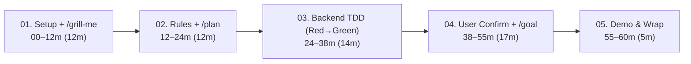

# Build Next-Gen Apps with Google Antigravity — 60-Minute Agentic TDD Lab Guide

Bring **your own app idea** (Productivity, Content Creation, Workflow, EdTech, or Utility) and go from an empty folder to a **TDD-verified, human-confirmed, Global Google Play–ready prototype** in **60 minutes (1 hour max)**.

> Looking for a full reference of every `agy` command, model, flag, rule trigger, skill, hook, and MCP integration? See [`AGY_FEATURES.md`](./AGY_FEATURES.md).

| Section & Clock | Time | What You Do | Output |
| :--- | :--- | :--- | :--- |
| **01 • Intro & Step 0** (`00–06m`) | `6 min` | Quick intro (`2m`) + install `agy` & sign in (`4m`) | Authenticated workspace |
| **01 • Step 1** (`06–12m`) | `6 min` | Scope app + backend API contract with `/grill-me` | `SPEC.md` |
| **02 • Step 2** (`12–16m`) | `4 min` | Add Global Play + Backend TDD + Confirmation rules | `.agents/rules/play-standards.md` |
| **02 • Step 3** (`16–24m`) | `8 min` | Generate & review a test-first blueprint with `/plan` | Approved TDD plan (`Ctrl+R`) |
| **03 • Step 4A** (`24–30m`) | `6 min` | **TDD `RED` Phase**: Write backend use-case tests first | Failing `tests/backend.test.js` |
| **03 • Step 4B** (`30–38m`) | `8 min` | **TDD `GREEN` Phase**: Build backend + Gemini 3.8 Flash + M3 UI | `100% PASS` backend + working UI |
| **04 • Step 5A** (`38–47m`) | `9 min` | **User Gate**: `agy` runs live use case & asks **YOU** to confirm | Human-approved JSON & UX |
| **04 • Step 5B** (`47–55m`) | `8 min` | Confirm results → run `/goal` regression & Play Store kit | `PLAY_STORE_LISTING.md` |
| **05 • Demo** (`55–60m`) | `5 min` | Lightning Show & Tell + wrap-up | Live showcase |



---

## Step 0: Install `agy` & Sign In (`00–06m` • 4 mins)

### 1. Install Antigravity CLI (`agy`)

**macOS / Linux:**
```bash
curl -fsSL https://antigravity.google/cli/install.sh | bash
agy --version
```

**Windows (PowerShell):**
```powershell
irm https://antigravity.google/cli/install.ps1 | iex
agy --version
```

### 2. Grab Your Free Google AI Studio Key (\$0 Free Tier)
Open [aistudio.google.com/apikey](https://aistudio.google.com/apikey), sign in with your personal Google Account, and click **Create API key** (**\$0 Free Tier** — no credit card or Google Cloud billing setup required):
- **`Gemini 3.8 Flash` (`gemini-3.8-flash` — Default)**: **100% free of charge** on the Google AI Studio Free Tier (both input and output/thinking tokens). Powers live structured JSON in your backend API and doubles as an instant BYOK CLI failover key!
- **`Gemini 4 Argon` (`gemini-4-argon` — Frontier Reasoning)**: Switch to `/model gemini-4-argon` inside `agy` for deep architectural planning when signed in with an eligible Pro/Ultra/Enterprise plan or a Paid/Cloud-credit API key *(note: `gemini-4-argon` is Paid Tier only on AI Studio, whereas `gemini-3.8-flash` runs free for everyone)*.

### 3. Create Your App Folder & Launch `agy`

**Option A — Personal Google Login (Recommended, 10 seconds):**
```bash
mkdir my-play-app && cd my-play-app
export GEMINI_API_KEY="<YOUR_API_KEY>"
agy
```
Select **`1. Google OAuth`** and sign in with your personal Google Account in the browser.

**Option B — Direct Google AI Studio Key Mode (No Browser Login):**
```bash
mkdir my-play-app && cd my-play-app
export GEMINI_API_KEY="<YOUR_API_KEY>"
agy --settings '{"modelProvider":"gemini"}'
```

> [!TIP]
> **Hit a rate or token limit mid-workshop?** Export a fresh `GEMINI_API_KEY` and run:
> ```bash
> agy -c --settings '{"modelProvider":"gemini"}'
> ```
> `-c` (`--continue`) resumes your **exact same conversation and files** on `gemini-3.8-flash` with zero lost progress. To make AI Studio mode permanent across sessions, add `"modelProvider": "gemini"` to `~/.gemini/antigravity-cli/settings.json`.

---

## Step 1: Scope Your App & Backend Contract with `/grill-me` (`06–12m` • 6 mins)

Let Antigravity interview you with 3 quick scoping questions so `SPEC.md` locks down both your UI workflow **and** a testable backend API schema.

**Copy & paste into `agy` (replace the bracketed line with your idea):**
```markdown
/grill-me I want to build a Google Play app for global Tier-1 markets (US, UK, AU).
My app idea is: [DESCRIBE YOUR APP IDEA IN 2-3 SENTENCES].

Ask me 3 quick scoping questions to lock down:
1. Core user workflow + 1 primary backend API endpoint (achievable in a 1-hour MVP)
2. Lightweight stack (zero-setup Node + Mobile Web/PWA, Flutter, or Kotlin Compose)
3. Exact gemini-3.8-flash structured JSON response fields & input validation rules so we can write backend TDD tests first

Wait for my answers before writing SPEC.md.
```

- Reply to the 3 questions (or type **`Go with recommended, and write SPEC.md only right now`**).
- **Sample Global App Ideas**:
  - **FocusBrief AI** (`POST /api/brief`): Turns messy meeting notes into prioritized `P0/P1/P2` action cards + Slack/email follow-ups.
  - **ReelHook AI** (`POST /api/hooks`): Turns product bullets into viral short-video hooks & shot lists.
  - **ReceiptSnap AI** (`POST /api/extract`): Parses freelance invoices/notes into categorized tax line items.
  - **PitchReady AI** (`POST /api/score`): Critiques startup or interview pitches with rubric scores & rewrites.

---

## Step 2: Add Global Play, Backend TDD & Confirmation Guardrails (`12–16m` • 4 mins)

Encode Test-Driven Development and Human-in-the-Loop confirmation into `.agents/rules/` so `agy` never skips backend tests, always targets current frontier models, and never ships unconfirmed outputs (a starter copy is also included at [`.agents/rules/play-standards.md`](./.agents/rules/play-standards.md)).

**Copy & paste into `agy`:**
```markdown
Create .agents/rules/play-standards.md starting with YAML frontmatter `trigger: always_on` that enforces:
1. Global Market First (US / Tier-1 Export): English (en-US) primary UI with clean string constants ready for multi-locale expansion, plus 390x844 Material 3 mobile UX (48px+ touch targets & 1-tap sample inputs).
2. Backend TDD First (Red -> Green): Always write executable backend API & Gemini JSON schema tests (e.g. tests/backend.test.js) BEFORE implementing backend feature logic.
3. User Result Confirmation: After running backend use-case tests, print the pass/fail table and actual returned JSON output, and explicitly ASK THE USER TO CONFIRM the results before generating Play Store release assets.
4. Latest Gemini Models & Security: Use gemini-3.8-flash (or gemini-4-argon when configured with a paid/credit key) with structured JSON output; never hardcode API keys in source or test files (read GEMINI_API_KEY from env with a deterministic offline demo fallback).
```

> [!IMPORTANT]
> Rule files inside `.agents/rules/` **must** include `trigger: always_on` in YAML frontmatter to stay active on every turn (or place rules in a root `AGENTS.md` file with no frontmatter).

---

## Step 3: Generate a Test-First Blueprint with `/plan` (`16–24m` • 8 mins)

Review your 3-milestone TDD plan before `agy` writes a single line of code. *(Optional: if signed in with a Pro/Enterprise plan or Cloud-credit key, run `/model gemini-4-argon` for deep architectural planning, or stay on `gemini-3.8-flash` for fast planning!)*

**Copy & paste into `agy`:**
```markdown
/plan Based on @SPEC.md and our play-standards rule, create a concise 3-milestone TDD implementation plan:
- Milestone 1 (RED): Backend API & Gemini structured JSON schema test suite (health check, HTTP 400 empty-input validation, HTTP 200 schema contract, and zero hardcoded API keys)
- Milestone 2 (GREEN): Backend service + live gemini-3.8-flash structured JSON integration (with deterministic offline fallback) + 390x844 Material 3 mobile UI with 1-tap sample inputs
- Milestone 3 (CONFIRM & SHIP): Run end-to-end backend use-case test, present actual output & ask user to confirm results, then run /goal for Play Store readiness
Do not write code yet.
```

1. Press **`Ctrl+R`** (or run `/artifact`) to inspect the plan.
2. Confirm **Milestone 1 writes backend tests before implementation** and uses built-in test tooling (such as `node:test`) with zero heavy dependencies.

---

## Step 4: Backend Test-Driven Development — `RED` → `GREEN` (`24–38m` • 14 mins)

### Step 4A (`RED` Phase — 6 mins): Implement Backend Use-Case Tests First
Write the backend tests **first** and verify they fail (`RED`) before any backend server exists.

**Copy & paste into `agy`:**
```markdown
TDD Step 1 (RED Phase): Execute Milestone 1 ONLY.
Write our backend use-case test suite first (e.g. tests/backend.test.js) covering:
1. GET /api/health returns HTTP 200
2. Empty or invalid input to our primary endpoint returns HTTP 400 validation error
3. A realistic domain input returns HTTP 200 matching every required structured JSON schema field in @SPEC.md
4. Source file scan verifying zero hardcoded Google API keys in repository files

Bind any test server to an ephemeral port (port 0). Run `node tests/backend.test.js` now to confirm it fails (RED) because the backend is not implemented yet, then stop.
```

> [!NOTE]
> Seeing **`FAIL` (`RED`)** here proves your tests genuinely exercise the backend contract rather than passing on empty stubs! Feel free to ask `agy` to add 1 custom edge case for your app idea.

### Step 4B (`GREEN` Phase — 8 mins): Build Backend, Gemini 3.8 Flash & Mobile UI to Pass
Now instruct `agy` to implement your backend endpoint and `390x844` Material 3 UI until every test turns `GREEN`.

**Copy & paste into `agy`:**
```markdown
TDD Step 2 (GREEN Phase): Execute Milestone 2 now!
1. Implement the backend API + gemini-3.8-flash structured JSON integration (reading GEMINI_API_KEY from env, with a deterministic offline demo fallback) so ALL tests in tests/backend.test.js pass.
2. Build the 390x844 Material 3 mobile UI wired to our backend endpoint, including 2-3 one-tap sample inputs.
3. Re-run `node tests/backend.test.js` and fix any issues until 100% of backend tests are GREEN!
```

- **Optional Power Move (`Ctrl+V`):** Copy a UI screenshot or sketch a quick wireframe, press **`Ctrl+V`** in `agy`, and ask it to match that card layout.
- **Spot-Check Anytime:** Type `! node tests/backend.test.js` directly inside `agy` to run your test suite yourself.

---

## Step 5: Live Use-Case Test, User Confirmation & `/goal` (`38–55m` • 17 mins)

### Step 5A (9 mins): Have `agy` Test a Live Use Case & Ask You to Confirm
Before packaging your app, have `agy` execute a real end-to-end scenario against your backend, show you the actual returned JSON, and wait for **your human sign-off**.

**Copy & paste into `agy`:**
```markdown
Run our full backend test suite (`node tests/backend.test.js`) AND execute an end-to-end live use-case test against our backend API using a realistic user input.

Show me:
1. Test suite pass/fail summary table
2. Exact input sent -> actual structured JSON returned by the backend
3. Local preview command/URL so I can click through the mobile UI

Then PAUSE and ask me to confirm whether these results match my expected use case!
```

**Your Confirmation Checklist:**
1. **Inspect the Returned JSON**: Are the priorities, fields, and summaries accurate and actionable?
2. **Request Tweaks (Optional)**: Want an extra field or stricter validation? Tell `agy` — it will update `tests/backend.test.js` and the backend together!
3. **Click Through the UI**: Open the local URL in your browser and tap a sample input chip.

### Step 5B (8 mins): Confirm Results & Run `/goal` for Your Play Store Kit
Once you are happy with the backend output and UI, confirm the results and trigger `/goal` to lock in regressions and generate your global store listing.

**Copy & paste into `agy`:**
```markdown
Confirmed — the backend use-case results look great!

/goal Run the complete backend & UI verification suite, verify zero hardcoded API keys exist in source files, and generate PLAY_STORE_LISTING.md for US/Global Google Play containing:
1. App Title (<= 30 chars) & Short Description (<= 80 chars)
2. Full Google Play Store Description (en-US, ASO-ready)
3. v1.0.0 Release Notes & Google Play Data Safety checklist
```

Run `/diff` inside `agy` to inspect every test, backend, UI, and store listing file created before the 5-minute Lightning Showcase!

---

## Quick Reference Cheat Sheet

| Command / Shortcut | What It Does |
| :--- | :--- |
| `/grill-me <idea>` | Interviews you to lock down app + backend API scope in `SPEC.md` |
| `/plan <prompt>` | Generates a reviewable TDD implementation blueprint before coding |
| `/goal <objective>` | Loops autonomously through test suites and bug-fixes until green |
| `/model` | Switches between `gemini-3.8-flash` (fast default) & `gemini-4-argon` (deep reasoning) |
| `/artifact` or `Ctrl+R` | Opens generated plans and artifacts for review |
| `/diff` | Shows uncommitted backend, test, and UI diffs in your workspace |
| `/compact` | Compresses long chat history to free up context tokens |
| `Ctrl+V` | Pastes a clipboard screenshot or wireframe image into your prompt |
| `@filename` | Pins specific files (`@SPEC.md`, `@tests/backend.test.js`) to context |
| `! node tests/backend.test.js` | Runs your backend test suite directly inside `agy` |
| `agy -c` | Resumes your most recent conversation (`--continue`) |
