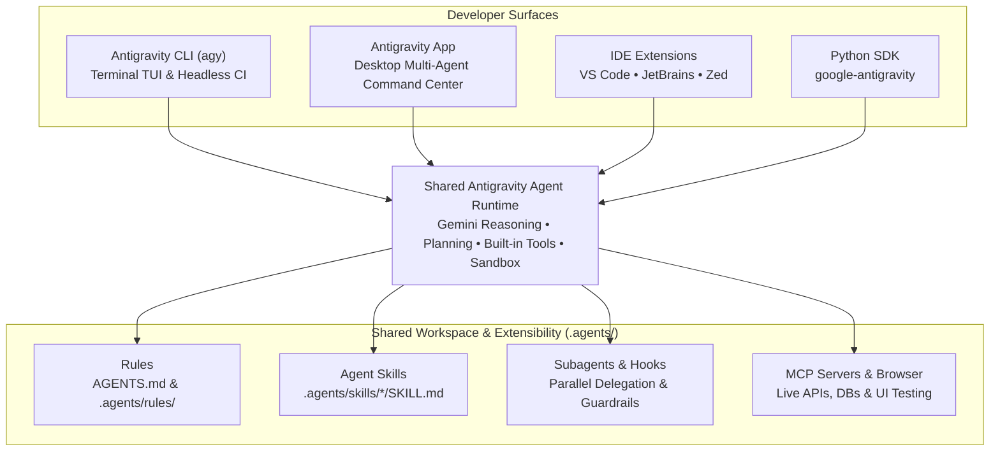

# Build Next-Gen Apps with Google Antigravity (`agy`)

A hands-on workshop guide and complete CLI/platform feature reference for going from an empty directory to a **Test-Driven (`RED` → `GREEN`), human-confirmed, mobile-first AI application** in **60 minutes** using **Google Antigravity** and **Gemini 2.5 Flash**.

## Repository Contents

| File | Description |
| :--- | :--- |
| [`HANDS_ON_LAB_GUIDE.md`](./HANDS_ON_LAB_GUIDE.md) | **60-Minute Hands-On Lab Guide**: Step-by-step copy-paste prompts covering `/grill-me` scoping, `/plan` blueprinting, Backend Test-Driven Development (`RED` → `GREEN`), live use-case result confirmation, and `/goal` release verification. |
| [`AGY_FEATURES.md`](./AGY_FEATURES.md) | **Google Antigravity (`agy`) Feature Reference**: Complete overview of CLI commands, slash workflows, headless `stream-json` mode, `AGENTS.md` & `.agents/rules/` triggers, `SKILL.md` skills, subagents, hooks, plugins, MCP, browser automation, Git worktrees, and the Python SDK. |
| [`.agents/rules/play-standards.md`](./.agents/rules/play-standards.md) | **Starter Workspace Guardrails (`trigger: always_on`)**: Enforces Backend TDD (`RED` → `GREEN`), human-in-the-loop result confirmation, Material 3 mobile UX, structured Gemini JSON outputs, and zero hardcoded API keys. |

## Quick Start

1. **Install the Antigravity CLI (`agy`)**:
   ```bash
   # macOS / Linux
   curl -fsSL https://antigravity.google/cli/install.sh | bash

   # Windows (PowerShell)
   irm https://antigravity.google/cli/install.ps1 | iex
   ```
2. **Grab a Free Gemini API Key** from [Google AI Studio](https://aistudio.google.com/apikey) (`GEMINI_API_KEY`).
3. **Open [`HANDS_ON_LAB_GUIDE.md`](./HANDS_ON_LAB_GUIDE.md)** and follow Steps `0` through `5`!

---

# Google Antigravity (`agy`) — Complete Feature Reference

A comprehensive developer guide to **Google Antigravity**, Google's agent-first software engineering platform powered by Gemini. Everything in this reference is grounded in publicly available product capabilities and [official Google Antigravity documentation](https://antigravity.google/docs).

---

## Table of Contents

1. [Platform Surfaces & Architecture](#1-platform-surfaces--architecture)
2. [Installation & Authentication](#2-installation--authentication)
3. [Execution Modes, Models & Artifacts](#3-execution-modes-models--artifacts)
4. [Interactive CLI (`agy`) Slash Commands & Shortcuts](#4-interactive-cli-agy-slash-commands--shortcuts)
5. [CLI Startup Flags, Subcommands & Headless CI/CD Mode](#5-cli-startup-flags-subcommands--headless-cicd-mode)
6. [Extensibility: Rules, Skills, Subagents, Hooks & Plugins](#6-extensibility-rules-skills-subagents-hooks--plugins)
7. [Model Context Protocol (MCP) Integration](#7-model-context-protocol-mcp-integration)
8. [Browser Automation, Git Worktrees & Remote Execution](#8-browser-automation-git-worktrees--remote-execution)
9. [Python SDK (`google-antigravity`)](#9-python-sdk-google-antigravity)
10. [Security, Sandboxing & Permission Controls](#10-security-sandboxing--permission-controls)
11. [Official Public Resources](#11-official-public-resources)

---

## 1. Platform Surfaces & Architecture

Google Antigravity shares a single underlying agent harness, configuration format, and customization ecosystem across four developer surfaces:



| Surface | Best For | Key Capabilities |
| :--- | :--- | :--- |
| **Antigravity CLI (`agy`)** | Terminal workflows, SSH sessions, rapid app prototyping, CI/CD automation | Lightweight Go-based TUI, slash commands, multimodal image paste, headless JSON/NDJSON streaming, low memory footprint |
| **Antigravity App** | Multi-agent orchestration & mission control | Manage parallel background agents across workspaces, inspect visual artifacts, schedule recurring automations |
| **IDE Extensions** | In-editor pair programming | Native agent side panels, inline tab-completion, task grouping, and interactive visual diff review in **VS Code** (`v1.90+`), **JetBrains IDEs** (`v2026.2.1+`), and **Zed** (`v0.140.0+`), plus side-by-side CLI sync with **Android Studio** and **Xcode** |
| **Python SDK** | Custom engineering pipelines & bots | Async Python interface (`pip install google-antigravity`) exposing the full stateful Antigravity runtime and toolset |

---

## 2. Installation & Authentication

### CLI Installation

**macOS & Linux:**
```bash
curl -fsSL https://antigravity.google/cli/install.sh | bash
agy --version
```

**Windows (PowerShell):**
```powershell
irm https://antigravity.google/cli/install.ps1 | iex
agy --version
```

Keep the CLI and shell `PATH` up to date at any time:
```bash
agy install   # Configure shell PATH and environment integration
agy update    # Update agy to the latest release
```

### Supported Authentication Modes

1. **Personal Google Account (OAuth)**
   - Run `agy` and choose Google sign-in to authenticate via browser OAuth (supports Free, Pro, and Ultra plans).
2. **Enterprise / Google Cloud Account**
   - Authenticate under Google Cloud terms (`Continue with Google Cloud`) for organization-governed access.
3. **Direct Gemini API Key Mode (Google AI Studio)**
   - Ideal for headless environments, workshops, SSH boxes without a local browser, or instant quota failover using a key from [Google AI Studio](https://aistudio.google.com/apikey):
   ```bash
   export GEMINI_API_KEY="<YOUR_API_KEY>"
   agy --settings '{"modelProvider":"gemini"}'
   ```
   - To persist API key mode across sessions, add `"modelProvider": "gemini"` to `~/.gemini/antigravity-cli/settings.json` while keeping `GEMINI_API_KEY` set in your environment.
4. **Session Sign-Out**
   - Run `/logout` inside `agy` to revoke session credentials and clear tokens from the system keyring.

---

## 3. Execution Modes, Models & Artifacts

### Execution Modes (`--mode`)

Antigravity lets you tune how much autonomy the agent exercises:

| Mode | CLI Flag | Behavior |
| :--- | :--- | :--- |
| **Planning Mode** | `--mode plan` | Read-only architectural discovery. Researches the repository, maps edge cases, and produces a structured implementation plan without modifying files. |
| **Accept-Edits Mode** | `--mode accept-edits` | Automatically applies file creation/edit operations while still prompting before executing potentially side-effecting shell commands. |
| **Auto Mode** | `--mode auto` | End-to-end autonomous execution paired with terminal sandboxing (`--sandbox`). |

### Frontier Model & Reasoning Effort Control

- **Model Selection (`/model` or `--model <name>`)**: Switch between fast low-latency Gemini Flash models and deep-reasoning frontier models mid-session.
- **Thinking Effort (`/effort` or `--effort <level>`)**: Dynamically set reasoning depth across `low`, `medium`, `high`, `xhigh`, or `max` depending on task complexity.

### Artifacts & Human-in-the-Loop Review

- **Artifacts** are structured deliverables produced by the agent — such as implementation plans, product specs, test reports, architectural diagrams, and UI walkthroughs.
- Toggle the **Artifact Review** pane with `/artifact` or **`Ctrl+R`** to inspect, comment on, or approve proposed plans (*Request Review* vs. *Always Proceed*) before code is written.

---

## 4. Interactive CLI (`agy`) Slash Commands & Shortcuts

Typing `/` in the interactive TUI opens a fuzzy-searchable command menu.

### Planning, Verification & Autonomous Execution

| Command | Description |
| :--- | :--- |
| `/grill-me [idea]` | **Reverse-interview scoping**: Interviews you one question at a time (with recommended defaults) to align on scope, stack, and schemas before writing a spec or code. |
| `/plan [prompt]` | Researches the workspace and drafts a step-by-step, reviewable implementation blueprint before modifying application code. |
| `/goal <objective>` | Runs in an autonomous build-test-fix loop until all tests pass and the objective is verified complete. |
| `/review` | Performs a structured code review of uncommitted changes, branches, or implementation artifacts for bugs and regressions. |
| `/artifact` | Opens generated plans and markdown artifacts for inspection and sign-off. |
| `/diff` | Displays uncommitted file diffs across the active workspace. |

### Session, Context & Configuration

| Command | Description |
| :--- | :--- |
| `/resume` | Browse and resume prior local conversations. |
| `/rewind` / `/undo` | Step backward to an earlier turn in the conversation trajectory. |
| `/fork` | Branch the current conversation from the active step while keeping workspace context. |
| `/compact` | Summarize and compress long conversation history to free context-window tokens. |
| `/clear` | Clear the current session and start a fresh conversation. |
| `/context` | Inspect files, rules, and token consumption currently loaded in context. |
| `/codesearch` | Search symbols and files across the workspace. |
| `/tasks` | View and manage running background shell tasks or subagent jobs. |
| `/model` | Switch the active model for the session. |
| `/effort` | View or adjust reasoning effort (`low` → `max`). |
| `/usage` / `/quota` / `/credits` | Open the interactive usage and quota panel for model request/token tracking. |
| `/config` / `/settings` | Open the full-screen TUI settings overlay (sandbox, theme, approvals, editor mode). |
| `/keybindings` | View or customize TUI keyboard shortcuts (including optional Vim modal editing). |
| `/copy` | Copy the latest agent response or code block to your system clipboard. |
| `/feedback` | Submit product feedback directly from the terminal. |
| `/logout` | Purge stored auth tokens and sign out. |
| `/exit` / `/quit` | Exit the interactive TUI (prints the exact resume command on exit). |

### Extensibility Management Slash Commands

| Command | Description |
| :--- | :--- |
| `/agents` | Open the subagent manager to inspect, switch, or spawn parallel background subagents. |
| `/skills` | List and inspect workspace and global `SKILL.md` skills. |
| `/mcp` | Manage connected Model Context Protocol servers and inspect tool health. |
| `/hooks` | Inspect active lifecycle hooks (`PreToolUse`, `PostToolUse`, `SessionStart`, `Stop`). |
| `/migrate-workflows` | Convert deprecated legacy workflow files into modern `SKILL.md` bundles. |

### Prompt Prefixes & Keyboard Shortcuts

| Input / Shortcut | Action |
| :--- | :--- |
| `@<path>` | Pin a file, folder, or manual rule (with live fuzzy path autocomplete) into prompt context. |
| `! <command>` | Execute a shell command directly inside `agy` (e.g., `! node tests/backend.test.js`). |
| `Ctrl + R` | Toggle the Artifact Review panel. |
| `Ctrl + V` | Paste an image, screenshot, or wireframe sketch from your clipboard into the prompt. |
| `Ctrl + K` | Quickly approve a pending tool execution request. |
| `Shift + Enter` / `Ctrl + J` | Insert a multi-line break without submitting the prompt. |
| `Esc` `Esc` | Clear the current prompt input box when idle. |

---

## 5. CLI Startup Flags, Subcommands & Headless CI/CD Mode

### Common Startup Flags

```bash
agy                                       # Start interactive TUI in current directory
agy -i "Refactor auth middleware"         # Start interactive TUI with an initial prompt
agy -c                                    # Continue (--continue) most recent conversation
agy --conversation <ID>                   # Resume a specific conversation ID
agy --add-dir ../shared-lib               # Attach additional workspace directories (repeatable)
agy --agent <name>                        # Launch session with a specific subagent
agy --model <model> --effort high         # Pin model and reasoning effort at startup
agy --mode plan                           # Start in read-only planning mode
agy --sandbox                             # Enable OS-level terminal containment
agy --settings '{"modelProvider":"gemini"}' # Apply transient JSON settings for this session only
```

### Headless Mode (`-p` / `--print`) & Structured Streaming

Use `-p` (`--print`) to run Antigravity non-interactively in scripts, pre-commit checks, or CI/CD pipelines (`stdout` receives clean output; `stderr` receives diagnostics):

```bash
# 1. Plain-text one-shot execution
agy -p "Summarize uncommitted git changes in 3 bullet points"

# 2. Single JSON result payload with metadata
agy -p "List potential null-pointer risks in src/" --output-format json

# 3. Real-time NDJSON event stream (tool calls, progress, token metrics)
agy -p "Run unit tests and explain any failures" --output-format stream-json

# 4. Enforce a strict JSON Schema on the final response
agy -p "Extract API endpoints" --output-format json --json-schema ./endpoints.schema.json
```

> **CI Security Note:** `--dangerously-skip-permissions` auto-approves tool prompts for unattended runs. Only use it inside isolated containers, disposable CI runners, or `--sandbox` environments.

### Top-Level CLI Subcommands

| Subcommand | Purpose |
| :--- | :--- |
| `agy agents` | List available built-in and custom subagents. |
| `agy models` | List available models for the current account/provider. |
| `agy mcp <add\|list\|enable\|disable\|remove>` | Configure Model Context Protocol servers from the command line. |
| `agy plugin <list\|install\|uninstall\|enable\|disable\|import\|validate>` | Manage plugins or import extensions. |
| `agy remote-control <start\|status\|stop>` | Manage the background remote-control daemon. |
| `agy mic-serve` | Forward local microphone input to an `agy` session over SSH. |
| `agy acp` | Start the Agent Client Protocol (`stdio` JSON-RPC) server for editor integrations. |
| `agy changelog` | Print release notes for the installed CLI version. |
| `agy install` / `agy update` | Configure shell `PATH` or self-update the `agy` binary. |

---

## 6. Extensibility: Rules, Skills, Subagents, Hooks & Plugins

### 1. Rules (`AGENTS.md` & `.agents/rules/*.md`)

Rules enforce persistent coding conventions, architecture boundaries, and testing standards (such as Test-Driven Development):

- **`AGENTS.md` (or `GEMINI.md`)**: Placed in your repository root or subdirectories. Always active for that directory subtree with **zero frontmatter required**.
- **Modular Rules (`.agents/rules/*.md`)**: Support YAML frontmatter to control exactly *when* each rule loads into context:

| Frontmatter `trigger` | When It Loads | Example Frontmatter |
| :--- | :--- | :--- |
| `always_on` | Injected on every turn in the workspace | `trigger: always_on` |
| `glob` | Loaded automatically when matching files are read/edited | `trigger: glob` + `globs: "**/*.test.ts, src/api/**"` |
| `model_decision` | Loaded dynamically when the task matches `description` | `trigger: model_decision` + `description: Database migration safety` |
| `manual` | Loaded only when explicitly pinned via `@rule-name` | `trigger: manual` |

> **Token Budget Optimization:** Active global and `always_on` rules share a **20,000-token** budget. If exceeded, Antigravity automatically converts larger files into lightweight descriptions and loads them on demand.

### 2. Agent Skills (`.agents/skills/<name>/SKILL.md`)

Skills are modular, open-standard capability packages that use **progressive disclosure** — Antigravity indexes only the YAML `name` and `description` at startup and loads the full markdown instructions and helper scripts only when relevant.

```text
.agents/skills/release-check/
├── SKILL.md          # Required: YAML frontmatter (name, description) + instructions
├── scripts/          # Optional: executable helper scripts
├── examples/         # Optional: reference implementations
└── references/       # Optional: detailed docs loaded on demand
```

*(Note: Legacy sequential `.agents/workflows/` files have been superseded by Skills; run `/migrate-workflows` to upgrade existing workflows automatically.)*

### 3. Subagents (`.agents/agents/*.md`)

Subagents run in isolated context windows with dedicated system prompts and tool scopes so deep codebase searches, browser checks, or security audits never clutter your main conversation:
- Built-in subagents include specialized research and browser agents.
- Define custom subagents as Markdown files under `.agents/agents/` (workspace) or globally, and invoke them automatically via delegation or explicitly with `agy --agent <name>` / `/agents`.

### 4. Lifecycle Hooks (`hooks.json`)

While rules guide *how* the model writes code, **Hooks** run deterministic shell scripts at specific runtime events:
- **`SessionStart`**: Inject environment checks or project metadata at startup.
- **`PreToolUse`**: Validate, audit, or block dangerous shell/file tool calls before execution.
- **`PostToolUse`**: Automatically run formatters (`prettier`, `gofmt`, `ruff`) or fast linters right after file edits.
- **`Stop`**: Verify tests pass or clean up resources before an agent turn concludes.

### 5. Plugins

Plugins bundle **Skills + Rules + Subagents + Hooks + MCP Servers** into a single namespaced unit that teams can share across repositories (`agy plugin install`, `agy plugin validate`).

---

## 7. Model Context Protocol (MCP) Integration

Antigravity natively supports the open **Model Context Protocol (MCP)** to connect agents to live external systems without manual copy-pasting:

- **Supported Transports**: Local `stdio` processes and remote `HTTP / SSE` endpoints (including OAuth authentication and custom headers).
- **Common Integrations**: Query database schemas (PostgreSQL, AlloyDB, Supabase, Neon), inspect deployment/build logs, read documentation wikis, or manage issue trackers (GitHub, Linear, Jira).
- **CLI Management**:
  ```bash
  agy mcp list
  agy mcp add <server-name> -- <command> [args...]
  agy mcp enable <server-name>
  agy mcp disable <server-name>
  ```

---

## 8. Browser Automation, Git Worktrees & Remote Execution

- **Built-In Browser Automation**: Antigravity includes an integrated, sandboxed Chromium browser subagent capable of launching local dev servers, clicking through user flows, reading DOM state and console errors, and capturing visual screenshots to verify frontend changes end-to-end.
- **Parallel Agents with Git Worktrees**: Spin up multiple concurrent tasks in isolated Git worktrees or branches — allowing one agent to build backend tests, another to refactor UI components, and a third to update docs without file lock conflicts, then review clean diffs before merging.
- **Remote Control & Remote Agents**:
  - `agy remote-control start` (or `--remote-control`) lets you monitor and steer a running CLI session remotely.
  - `--remote-agent` offloads heavy execution to managed remote environments so long-running tasks continue even if your laptop disconnects.

---

## 9. Python SDK (`google-antigravity`)

Embed the stateful Antigravity agent runtime directly inside Python applications and engineering automation:

```bash
pip install google-antigravity
```

```python
import asyncio
from google.antigravity import Agent, LocalAgentConfig

async def main():
    # Authenticate via GEMINI_API_KEY or Google Cloud / ADC credentials
    config = LocalAgentConfig()
    async with Agent(config) as agent:
        response = await agent.chat(
            "Run the backend test suite and summarize any failing assertions."
        )
        print(await response.text())

if __name__ == "__main__":
    asyncio.run(main())
```

---

## 10. Security, Sandboxing & Permission Controls

- **OS-Level Terminal Sandbox (`--sandbox`)**: Restricts filesystem writes and network/process boundaries when running shell commands autonomously.
- **Granular Tool Approvals**: Configure terminal command allowlists/denylists, browser URL policies, and file-edit approval modes in `/settings` (`~/.gemini/antigravity-cli/settings.json`).
- **Workspace Secret Hygiene**: Combine `.gitignore`, `AGENTS.md` / `.agents/rules/` policies, and `PreToolUse` hooks to ensure API keys (`GEMINI_API_KEY`) are read strictly from environment variables and never committed to source control.

---

## 11. Official Public Resources

- **Google Antigravity Home**: https://antigravity.google/
- **Official Documentation**: https://antigravity.google/docs
- **Download App & CLI**: https://antigravity.google/download
- **Plans & Pricing**: https://antigravity.google/pricing
- **Release Changelog**: https://antigravity.google/changelog
- **Engineering Blog**: https://antigravity.google/blog
- **Google AI Studio (API Keys)**: https://aistudio.google.com/apikey

---

## License

Licensed under the [Apache License 2.0](./LICENSE).
